# tunelet

tunelet is a Rust library for vocal pitch correction, choir, harmony,
formant control and effects. It is also available as an npm package for
browsers and Node.js.

[](https://crates.io/crates/tunelet)
[](https://www.npmjs.com/package/tunelet)
[](https://docs.rs/tunelet)
[](LICENSE)

**[Website](https://tunelet.byteland.app)** ·
[crates.io](https://crates.io/crates/tunelet) ·
[npm](https://www.npmjs.com/package/tunelet) ·
[GitHub Packages](https://github.com/ByteLandTechnology/tunelet/pkgs/npm/tunelet) ·
[API documentation](https://docs.rs/tunelet)


## Contents

- [Features](#features)
- [Installation](#installation)
- [Quick start](#quick-start)
- [Signal chain](#signal-chain)
- [Process audio](#process-audio)
- [Timed events](#timed-events)
- [Lifecycle](#lifecycle)
- [Feedback and telemetry](#feedback-and-telemetry)
- [Real-time rules](#real-time-rules)
- [WebAssembly and TypeScript](#webassembly-and-typescript)
- [Build from source](#build-from-source)
- [License](#license)

## Features

- **Pitch correction**: The processor moves the voice to the nearest note in
  a scale. A MIDI keyboard can also select the notes.
- **Choir**: The processor adds a maximum of 15 voices with random pitch
  drift and delay.
- **Harmony**: The processor adds a maximum of four voices from intervals,
  chords or MIDI notes.
- **Formant control**: An LPC model changes the width and the length of the
  vocal tract.
- **Effects**: Punch, Warm, Alien and six reverb modes are available.
- **Sample-exact output**: All stages use fixed-point arithmetic. The
  same input, configuration and seed give the same samples.
- **Real-time safety**: After construction, the audio calls do not allocate
  memory, acquire locks or do I/O.
- **No dependencies**: The default Rust build has no dependencies and uses
  only safe Rust.

The input is mono signed 16-bit PCM or normalized 32-bit floating-point audio
at 44.1 kHz or 48 kHz. The output is stereo or mono in 16-bit PCM or 32-bit
floating-point form.

## Installation

tunelet is available from these registries:

| Registry        | Package                                                                                         | Use               |
| --------------- | ----------------------------------------------------------------------------------------------- | ----------------- |
| crates.io       | [`tunelet`](https://crates.io/crates/tunelet)                                                   | Rust              |
| npm             | [`tunelet`](https://www.npmjs.com/package/tunelet)                                              | Browsers, Node.js |
| GitHub Packages | [`@bytelandtechnology/tunelet`](https://github.com/ByteLandTechnology/tunelet/pkgs/npm/tunelet) | Browsers, Node.js |

For Rust, add the crate:

```sh
cargo add tunelet
```

For browsers and Node.js, install the npm package:

```sh
npm install tunelet
```

The GitHub Packages registry has the same package with a scoped name. To
use it, add this line to the `.npmrc` file of your project:

```ini
@bytelandtechnology:registry=https://npm.pkg.github.com
```

Then install the package. GitHub Packages needs a token with the
`read:packages` scope, also for public packages.

```sh
npm install @bytelandtechnology/tunelet
```

If you use the scoped package, import from `@bytelandtechnology/tunelet`.

## Quick start

### Rust

```rust
use tunelet::{
    CorrectionScale, NoteMask, PitchClass, PrepareConfig, Processor, ProcessorConfig,
    SampleRate,
};

fn main() -> Result<(), tunelet::Error> {
    // 1. Set the sample rate and the largest block.
    let rate = SampleRate::try_from(48_000)?;
    let preparation = PrepareConfig::new(rate, 1024)?;

    // 2. Start from the default configuration and change fields.
    let mut config = ProcessorConfig::default();
    config.resynthesis.correction.notes =
        NoteMask::from_key_scale(PitchClass::A, CorrectionScale::Minor);
    config.resynthesis.correction.retune_ms = 20.0;

    // 3. Construct the processor. Only this step allocates memory.
    let mut processor = Processor::new(preparation, config)?;

    // 4. Process blocks. Each input sample gives one stereo frame.
    let input = [0i16; 1024];
    let mut output = [[0i16; 2]; 1024];
    processor.process(&input, &mut output, &[])?;

    // 5. After the last block, get the tail.
    processor.begin_drain();
    loop {
        let frames = processor.drain(&mut output)?;
        if frames == 0 {
            break;
        }
        // Use only output[..frames].
    }
    Ok(())
}
```

### TypeScript

```ts
import { loadTunelet, Tunelet, defaultConfig } from "tunelet";

await loadTunelet();
const config = defaultConfig();
config.resynthesis.pitchRatio = 1.25;
const processor = new Tunelet(48000, 1024, config);

const input = new Int16Array(1024);
const left = new Int16Array(1024);
const right = new Int16Array(1024);
// Fill input with mono PCM before each call; reuse all three arrays.
processor.process(input, left, right);

// After all processing and optional drain calls:
processor.free();
```

## Signal chain

The processor sends each sample through these stages, in this order. The
default configuration enables chromatic pitch correction and one choir
voice. It disables the effects and the formant stage.

| Stage          | Function                                                    | Default        | Configuration field      |
| -------------- | ----------------------------------------------------------- | -------------- | ------------------------ |
| Punch          | Input gain and transient enhancement                        | Disabled       | `punch`                  |
| Warm           | Asymmetric saturation and a 50 Hz high-pass filter          | Disabled       | `warm`                   |
| Pitch tracking | Finds the pitch of the voice                                | Enabled        | `resynthesis.pitch`      |
| Correction     | Moves the pitch to the nearest permitted note               | Chromatic      | `resynthesis.correction` |
| Voices         | Renders a choir (1 to 16 voices) or harmony (lead and 0–4)  | Choir, 1 voice | `resynthesis.mode`       |
| Formant        | Changes the vocal tract with an LPC model and aspiration    | Disabled       | `resynthesis.formant`    |
| Alien          | Plays recent audio in reverse loops                         | Disabled       | `alien`                  |
| Reverb         | Echo, Schroeder, SmallRoom, Binaural, MediumHall, LargeHall | Disabled       | `reverb`                 |
| Output gain    | Linear gain, 0..=64, before `-32767..=32767` clipping       | 1              | `output_gain`            |

The internal Q14 stages use `i64` products and saturate at the `i32`
limits. Decrease `output_gain` to prevent `-32767..=32767` clipping on
multi-voice mixes.

`resynthesis.correction.humanize` sets the relaxation on sustained notes, in
`0..=1`. The default is 0. `resynthesis.correction.flex_tune` sets the outer
fraction of each half-bin where pull toward the target decreases, in `0..=1`.
The default is 0, which applies full pull across the whole bin.

`resynthesis.dry_mix` sets the dry fraction at the resynthesis stage. The
dry path starts after Warm and has a delay of 1,593 frames. All six reverb
modes keep the stereo dry signal.

### Harmony sources

Set `resynthesis.mode` to `Harmony`. Then select the source of the voices
with `resynthesis.harmony.source`:

| Source          | The voices follow                                      |
| --------------- | ------------------------------------------------------ |
| `FixedInterval` | A fixed number of semitones from the singer            |
| `SmartInterval` | An interval in scale steps, in a key and a scale       |
| `ChordByDegree` | A chord on a scale degree                              |
| `ChordByName`   | A named chord, for example `MinorSeventh`              |
| `ChordViaMidi`  | The active MIDI notes, as a chord                      |
| `MidiOmni`      | MIDI notes from all channels, on the first free voice  |
| `MidiChannels`  | MIDI channel `n` for voice `n` (channels 0–3), default |

`resynthesis.harmony.voices` sets the number of interval voices, in `0..=4`.
The default is 4. `FixedInterval` and `SmartInterval` use the first `voices`
voices. The other voices release with the usual gain envelope. The chord
and MIDI sources ignore this field.

`resynthesis.harmony_gain` scales the four harmony voices in mono and in
stereo. It does not scale the lead voice.

## Process audio

To prepare a processor, do these steps:

1. Use `SampleRate::try_from(hz)` to check the input rate.
2. Use `PrepareConfig::new(rate, max_block_frames)` to set a nonzero block
   limit.
3. Create a `Processor` with that preparation and a `ProcessorConfig`.

Configuration structures implement `Default`. To select voices and effects,
edit their fields. To change the sample rate or the block limit, make a new
processor.

Select the process function for your output layout:

| Output layout                        | Function for input          | Function for the tail |
| ------------------------------------ | --------------------------- | --------------------- |
| `[[i16; 2]]` stereo frames           | `process`                   | `drain`               |
| `[[f32; 2]]` stereo frames           | `process_f32`               | `drain_f32`           |
| Separate `i16` left and right slices | `process_planar`            | `drain_planar`        |
| Separate `f32` left and right slices | `process_planar_f32`        | `drain_planar_f32`    |
| Mono `i16` slice                     | `process_mono_in_place`     | `drain_mono`          |
| Mono `f32` slice                     | `process_mono_in_place_f32` | `drain_mono_f32`      |

The `f32` methods convert `NaN` input samples to `0`. They clamp other input
values to `-1.0..=1.0`, multiply by `32767.0` in `f64` and round to `i16`. They
divide each `i16` output sample by `32768.0` and fill unused tail frames with
`0.0`.

These rules apply to each call:

- Each input sample gives one output frame.
- The channel lengths must be equal.
- The block must not be longer than the prepared block limit.
- Short blocks and empty blocks are permitted.
- If the call fails, the output and the state do not change.

## Timed events

To apply a control immediately before a specific frame, give `TimedEvent`
values to the process call.



These rules apply to the offsets:

- Offsets start at zero in each block.
- Each offset must be in the block.
- An offset must not be less than the offset before it.

Events with equal offsets execute in slice order. An empty block accepts no
events. A stage event replaces all settings of that stage. Use
`ControlEvent::Parameter` with `ParameterControl` to change one scalar field.
Use `ControlEvent::Patch` to change selected fields, or start from
`processor.config()`.

Harmony MIDI uses `ControlEvent::Midi`. MIDI for the correction keyboard uses
`ControlEvent::CorrectionMidi`. For example, these events change the resynthesis
dry mix at frame 0 and start a harmony note at frame 256:

```rust
use tunelet::{ControlEvent, MidiEvent, ParameterControl, TimedEvent};

let events = [
    TimedEvent {
        offset: 0,
        event: ControlEvent::Parameter(ParameterControl::DryMix(0.25)),
    },
    TimedEvent {
        offset: 256,
        event: ControlEvent::Midi(MidiEvent::NoteOn { channel: 0, note: 64, velocity: 100 }),
    },
];
processor.process(&input, &mut output, &events)?;
```

### Scalar parameters

`ControlEvent::Parameter` accepts these `ParameterControl` variants. All ranges
are inclusive, and `f32` values must be finite.

| Variant                       | TypeScript `type`               | Configuration field                     | Range             |
| ----------------------------- | ------------------------------- | --------------------------------------- | ----------------- |
| `PunchGainDb`                 | `"punchGainDb"`                 | `punch.gain_db`                         | `-96..=12` dB     |
| `PunchImpact`                 | `"punchImpact"`                 | `punch.impact`                          | `0..=1`           |
| `PunchCeilingDb`              | `"punchCeilingDb"`              | `punch.ceiling_db`                      | `-96..=0` dBFS    |
| `PunchAttackMs`               | `"punchAttackMs"`               | `punch.attack_ms`                       | `0.01..=5000` ms  |
| `WarmDriveDb`                 | `"warmDriveDb"`                 | `warm.drive_db`                         | `0..=6` dB        |
| `PitchThreshold`              | `"pitchThreshold"`              | `resynthesis.pitch.threshold`           | `0.002..=0.2`     |
| `RetuneMs`                    | `"retuneMs"`                    | `resynthesis.correction.retune_ms`      | `0..=400` ms      |
| `Humanize`                    | `"humanize"`                    | `resynthesis.correction.humanize`       | `0..=1`           |
| `FlexTune`                    | `"flexTune"`                    | `resynthesis.correction.flex_tune`      | `0..=1`           |
| `PitchRatio`                  | `"pitchRatio"`                  | `resynthesis.pitch_ratio`               | `0.25..=4`        |
| `FormantWidth`                | `"formantWidth"`                | `resynthesis.formant.width`             | `0.5..=2`         |
| `FormantStretch`              | `"formantStretch"`              | `resynthesis.formant.stretch`           | `0.5..=2`         |
| `FormantAspirationMix`        | `"formantAspirationMix"`        | `resynthesis.formant.aspiration_mix`    | `0..=1`           |
| `FormantAspirationCutoffHz`   | `"formantAspirationCutoffHz"`   | `resynthesis.formant.aspiration_cutoff_hz` | `500..=10000` Hz |
| `ChoirVoices`                 | `"choirVoices"`                 | `resynthesis.choir_voices`              | `1..=16`          |
| `ChoirDetune`                 | `"choirDetune"`                 | `resynthesis.choir_detune`              | `10..=100`        |
| `ChoirDelay`                  | `"choirDelay"`                  | `resynthesis.choir_delay`               | `20..=200`        |
| `ChoirSpreadPercent`          | `"choirSpreadPercent"`          | `resynthesis.choir_spread_percent`      | `0..=100`%        |
| `HarmonyRegisterPercent`      | `"harmonyRegisterPercent"`      | `resynthesis.harmony.register_percent`  | `0..=100`%        |
| `HarmonyVoicingSpreadPercent` | `"harmonyVoicingSpreadPercent"` | `resynthesis.harmony.voicing_spread_percent` | `0..=100`%   |
| `HarmonyPortamentoMs`         | `"harmonyPortamentoMs"`         | `resynthesis.harmony.portamento_ms`     | `0..=10000` ms    |
| `HarmonyVoices`               | `"harmonyVoices"`               | `resynthesis.harmony.voices`            | `0..=4`           |
| `HarmonyGain`                 | `"harmonyGain"`                 | `resynthesis.harmony_gain`              | `0..=1`           |
| `HarmonicModulation`          | `"harmonicModulation"`          | `resynthesis.harmonic_modulation`       | `0..=24`          |
| `DryMix`                      | `"dryMix"`                      | `resynthesis.dry_mix`                   | `0..=1`           |
| `ReverbMix`                   | `"reverbMix"`                   | `reverb.mix`                            | `0..=1`           |
| `ReverbDiffusion`             | `"reverbDiffusion"`             | `reverb.diffusion`                      | `0..=1`           |
| `ReverbDecay`                 | `"reverbDecay"`                 | `reverb.decay`                          | `0..=1`           |
| `ReverbBrightnessHz`          | `"reverbBrightnessHz"`          | `reverb.brightness_hz`                  | `80..=20000` Hz   |

## Lifecycle


### Construction

Construction validates the configuration and allocates all the storage of
the processor. After construction, no call allocates memory.

### Drain

The drain gives the tail of the reverb and the voices after the last input
block. To get the tail, do these steps:

1. Call `begin_drain()` one time.
2. Call the drain method for your layout until the call returns zero.
3. From each drain call, use only the frames that the call returns.

The drain fills the unused output with zeros. The drain has a finite budget,
`tail_frames()`, which can include silence. The last drain call resets the
audio histories and the feedback. A successful call that processes audio or
sets the configuration cancels the drain. `reset()` also cancels the drain.

### Reset

`reset()` keeps the configuration, the random stream and some controller and
filter state. If you need a fully new state, construct a new processor.

## Feedback and telemetry

These calls read the state of the processor. They do not change the audio.

| Call                 | Data                                                              |
| -------------------- | ----------------------------------------------------------------- |
| `control_activity()` | Which choir, harmony and reverb controls are active               |
| `feedback()`         | The pitch, the output peak, the correction ratio, the frame count |
| `take_feedback()`    | The same data as `feedback()`, and clears the peak window         |
| `telemetry()`        | Data for meters and displays (refer to the list below)            |
| `take_telemetry()`   | The same data as `telemetry()`, and clears its three peak windows |
| `latency_frames()`   | 1,593 frames of nominal resynthesis latency at both sample rates  |
| `formant_envelope()` | The LPC envelopes before and after the formant controls           |

`Processor::control_activity()` and `ProcessorConfig::control_activity()`
return a `ControlActivity` struct. A `false` flag means that the related
control makes no sample change in the active voice mode, harmony source or
reverb network.

The telemetry includes these items:

- The pitch, the correction ratio and the frame count from the feedback.
- The pitch ratio and the gain of each active voice.
- The peaks of the input, of the two output channels and of the reverb wet
  signal.
- The pitch clarity, which is a confidence score from 0 to 1.
- The current gains of Punch and Warm, and the position in the Alien loop.

`active_voice_ratios()` and `active_voice_gains()` return slices for the active
voices. The peak windows of the telemetry are independent of the peak window of
the feedback. In mono calls, the output and reverb wet peaks measure the audio
after the downmix. The dry path has the 1,593-frame delay. Resampled voices,
choir delays and effects use different delays.

`formant_envelope()` writes two LPC envelopes into slices of equal length:

- The vocal-tract envelope from the analysis.
- The envelope after the width and stretch controls.

The values are linear and have no absolute level. The formant stage must be
enabled. The envelopes are those of the model that the audio used for the
last frame. The method returns `Result<bool, Error>`:

| Result      | Description                                                      |
| ----------- | ---------------------------------------------------------------- |
| `Ok(true)`  | The slices contain valid envelopes.                              |
| `Ok(false)` | No model is available. The method fills both slices with zeros.  |
| `Err(_)`    | An argument is not valid. The method does not change the slices. |

## Real-time rules

Construction allocates the storage of the processor. These operations do not
allocate memory, acquire locks or do I/O:

- Processing
- Configuration
- Control activity
- MIDI
- Feedback
- Telemetry
- Reset
- Drain

All operations that can fail do their validation before they change the
state or the output. The crate forbids unsafe Rust.

The API documentation gives the parameter ranges, the MIDI behavior and the
reset semantics. Read it on [docs.rs](https://docs.rs/tunelet), or run this
command:

```sh
cargo doc --locked --no-deps --open
```

## WebAssembly and TypeScript

For `wasm32-unknown-unknown`, the optional `wasm` feature of the crate gives
JavaScript bindings and generated TypeScript declarations. The npm package
contains these bindings.

The npm package is one ES module for both browsers and Node.js. It contains
these items:

- One Wasm binary.
- The generated bindings.
- A shared `loadTunelet` entry point.

### Load the module

Both environments use the same imports and the same initialization call. An
import of the package does not load the binary. Call `loadTunelet()` before
you use `Tunelet` or `defaultConfig()`.

- Node.js reads the packaged binary from a file URL relative to the module.
- Browsers fetch the served Wasm asset.

Concurrent calls share one initialization promise. The package keeps the
result of a successful initialization. If a load fails, the promise rejects,
and you can try again. A Node.js file error goes to the caller.

For a custom asset location, give one of these sources to
`loadTunelet(source)`:

- A URL or URL string.
- A fetch Response.
- A byte buffer.
- A compiled `WebAssembly.Module`.
- A promise for one of these.

In Node.js, `loadTunelet` reads `file:` `URL` objects and `"file:"` URL strings
from disk. Other URLs and string sources obey fetch rules. The first concurrent
call selects the source. Later arguments do not replace an initialized module.
A custom binary must match the generated bindings.

The package root also exports `loadTunelet` as its default export. For direct
control of Wasm initialization, `tunelet/wasm` gives the generated default
initializer and `initSync`. The package root re-exports `initSync` too. The
package exports the Wasm binary at `tunelet/pkg/tunelet_bg.wasm` and
`tunelet/tunelet_bg.wasm`. Use only one initialization entry point for each
module instance.

The package gives only ESM exports. CommonJS applications can use
`await import("tunelet")`.

### Deployment

Browser bundlers must keep or emit the Wasm asset that
`new URL(..., import.meta.url)` refers to. For a browser deployment without a
bundler, do these steps:

1. Serve `dist/` and `pkg/`, and keep their relative layout.
2. Map the `tunelet` import to `dist/index.js`, or import that URL directly.

Serve the assets over HTTP(S). The package does not support a local `file:`
page that opens the JavaScript.

### TypeScript API

| Operation                         | TypeScript API                                                           |
| --------------------------------- | ------------------------------------------------------------------------ |
| Shared initialization             | `loadTunelet(source?)`                                                   |
| Mono `Int16Array` to stereo       | `process(input, left, right, events?)`                                   |
| Mono `Float32Array` to stereo     | `processF32(input, left, right, events?)`                                |
| In-place `Int16Array` mono        | `processMono(audio, events?)`                                            |
| In-place `Float32Array` mono      | `processMonoF32(audio, events?)`                                         |
| Fixed `Float32` buffer offsets    | `inputF32Ptr`, `leftF32Ptr`, `rightF32Ptr`                               |
| Cached `Float32` memory views     | `new TuneletAudioViews(memory, processor)`                               |
| Zero-copy `Float32` stereo        | `processF32InPlace(frames, events?)`                                     |
| Zero-copy `Float32` mono          | `processMonoF32InPlace(frames, events?)`                                 |
| Configuration                     | `config()`, `setConfig(config)`, `patchConfig(patch)`, `defaultConfig()` |
| Control activity                  | `controlActivity()`                                                      |
| Information about the preparation | `sampleRate`, `maxBlockFrames`, `latencyFrames`                          |
| Feedback                          | `feedback()`, `takeFeedback()`                                           |
| Telemetry                         | `telemetry()`, `takeTelemetry()`                                         |
| Formant envelopes                 | `formantEnvelope(maxFrequencyHz, input, output)`                         |
| `Int16Array` finite tail          | `beginDrain()`, `drain(left, right)`, `drainMono(audio)`                 |
| `Float32Array` finite tail        | `beginDrain()`, `drainF32(left, right)`, `drainMonoF32(audio)`           |
| Zero-copy `Float32` tail          | `beginDrain()`, `drainF32InPlace(frames)`, `drainMonoF32InPlace(frames)` |
| Configured tail budget            | `tailFrames()`                                                           |
| Reset or release memory           | `reset()`, `free()`, `views.dispose()`                                   |

### Audio buffers

The package offers copied `Int16Array` and `Float32Array` calls and zero-copy
in-place `Float32` calls. All blocks must fit in `maxBlockFrames`. This
package does not install an AudioWorklet or an integration with an audio
device.

For `process`, `processMono`, `drain`, `drainMono`, `processF32`,
`processMonoF32`, `drainF32` and `drainMonoF32`, pass `Int16Array` or
`Float32Array` buffers. These rules apply:

- Stereo output arrays must not overlap.
- The input can overlap an output, because the binding copies the input
  first.
- Buffers must stay attached during each call.

For `Float32` input, `NaN` becomes `0`, and other values clamp to `-1..=1`,
multiply by `32767` in `f64` and round to `-32767..=32767`. Each `Float32`
output sample divides the clipped `i16` sample or downmix by `32768`, and
unused drain frames get `0`. Web Audio channels can go directly to
`processF32` or `processMonoF32`.

For zero-copy blocks in an AudioWorklet, bind `TuneletAudioViews` to
`InitOutput["memory"]` and a `Tunelet` instance:

```ts
const wasm = await loadTunelet();
const processor = new Tunelet(48000, 128);
const views = new TuneletAudioViews(wasm.memory, processor);

views.input.set(monoChunk); // monoChunk.length <= 128
processor.processF32InPlace(monoChunk.length);
const left = views.left;
const right = views.right;

views.dispose();
processor.free();
```

`inputF32Ptr`, `leftF32Ptr` and `rightF32Ptr` stay at fixed byte offsets until
`processor.free()`. Copied `Float32Array` calls and in-place `Float32` calls
share those three `f32` buffers. Mono in-place calls read and write
`views.input`. Stereo in-place calls read `views.input` and write `views.left`
and `views.right`.

These lifetime rules apply to `Float32` views:

- A new `Tunelet`, `setConfig`, `patchConfig`, `events`, `controlActivity`,
  feedback, telemetry or `formantEnvelope` can grow Wasm memory and detach
  `memory.buffer`.
- Read `views.input` before each input write so `TuneletAudioViews` checks
  `memory.buffer` and refreshes detached views.
- If an in-place call supplies `events`, read `views.left` and `views.right`
  (or `views.input` for mono) again after that call.
- When you finish with the views, call `views.dispose()`.
- Do not read or write the views or pointers of an instance after
  `processor.free()`, because `free()` returns those buffers to the allocator.

### Configuration objects

Configuration objects contain all required fields. They use camelCase names
and show enums as string literals. To change the configuration, do these steps:

1. Start from `defaultConfig()` or `config()`.
2. Edit the necessary fields.
3. Call `setConfig()`.

If a required field is absent or a value is not valid, the call throws a
JavaScript `Error`. If an optional field is absent or `undefined`, it gets its
default. `resynthesis.correction.humanize` and
`resynthesis.correction.flexTune` default to 0, and
`resynthesis.harmony.voices` defaults to 4. The conversion ignores extra object
properties. The generated declarations contain the parameter documentation from
the Rust types.

To change selected fields without a full configuration copy, give a
`ProcessorConfigPatch` object to `patchConfig(patch)`. All fields in
`ProcessorConfigPatch` and the stage patches are optional. Absent or `undefined`
fields keep their active values on the processor. `patchConfig()` validates the
supplied fields and the pitch bounds before any state changes. Each successful
call cancels an active drain, also for an empty `{}` patch.

`resynthesis.randomSeed` and the `processedFrames` field of feedback and
telemetry use `bigint`. Frame offsets, block lengths and latency use
`number`.

### Events

The optional event argument is a `TimedEvent[]`. Controls use a `type`
discriminant and a `value` payload. The reset control has no payload. For
example, this event changes the final gain before the first frame:

```ts
{ offset: 0, event: { type: "outputGain", value: 0.5 } }
```

To merge selected configuration fields before a frame, use
`ControlEvent::Patch` (`type: "patch"`):

```ts
{ offset: 0, event: { type: "patch", value: { resynthesis: { dryMix: 0.2 } } } }
```

A scalar parameter event nests a `ParameterControl` object:

```ts
{ offset: 0, event: { type: "parameter", value: { type: "dryMix", value: 0.25 } } }
```

A harmony Note On event has this form:

```ts
{ offset: 0, event: { type: "midi", value: { type: "noteOn", channel: 0, note: 60, velocity: 100 } } }
```

Use `correctionMidi` for the separate correction keyboard. The native rules
for event order and for the validation of the whole block also apply to these
bindings.

### Feedback, telemetry and formant envelopes

`controlActivity()` returns a `ControlActivity` object with camelCase boolean
flags for the choir, harmony and reverb controls. `telemetry()` and
`takeTelemetry()` return a `Telemetry` object. In `Telemetry`, `voiceRatios`
and `voiceGains` are `Float32Array` values of length `voiceCount`.

In feedback and telemetry, `targetMidiNote` is `undefined` in these cases,
which are also the cases where `voiced` is `false`:

- The kept pitch estimate is unvoiced. This includes the time before the
  first detection and after a reset or a drain completion.
- The estimated frequency is outside the inclusive reporting bounds
  `resynthesis.pitch.minFrequencyHz` and `resynthesis.pitch.maxFrequencyHz`.

`formantEnvelope(maxFrequencyHz, input, output)` fills two `Float32Array`
buffers of equal length and returns `false` if no envelope is available.
In that case, it fills both buffers with zeros. If the lengths are not equal
or the frequency is not valid, it throws and does not change the buffers. The
frequency must be finite, more than zero and not more than half of the sample
rate. The class keeps a buffer for the points, so only the first call and a
call with more points than before reserve memory.

### Memory allocation

The constructor allocates reusable `i16` and `f32` buffers of length
`maxBlockFrames`. The processor also keeps an event buffer and uses its
capacity again across calls. `processF32InPlace`, `processMonoF32InPlace`,
`drainF32InPlace` and `drainMonoF32InPlace` without `events` do not allocate
Rust storage, make JavaScript views or call JavaScript imports. If Wasm memory
does not grow, `TuneletAudioViews` also allocates no new `Float32Array` views
after construction.

`Int16Array` and `Float32Array` buffer calls copy samples across the boundary
and make temporary views in the generated glue. These operations can also
allocate and grow Wasm memory:

- A new `Tunelet` instance.
- Configuration conversion.
- Supplied events when a call gives more events than before, or when an event
  converts a configuration or a patch.
- Errors.
- Control activity, feedback and telemetry.
- The formant envelopes.

Drain completion and reset keep the same state as the equivalent Rust
functions.

## Build from source

### Rust crate

To build the crate and check the format, the lints, the documentation and
the archive, run these commands:

```sh
cargo rustc --locked --lib --release -- -D warnings
cargo fmt --check
cargo clippy --locked --lib -- -D warnings
cargo rustdoc --locked --lib -- -D warnings
cargo package --locked
```

To check the `wasm` feature for `wasm32-unknown-unknown` with Cargo, run
these commands:

```sh
rustup target add wasm32-unknown-unknown
cargo clippy --locked --release --lib --target wasm32-unknown-unknown --features wasm -- -D warnings
cargo rustdoc --locked --release --lib --target wasm32-unknown-unknown --features wasm -- -D warnings
```

Native Rust builds and these Wasm checks use Cargo and do not need Node.js
or npm.

### npm package

Install Node.js and `wasm-pack`. Then add the `wasm32-unknown-unknown`
target, install the dependencies, check the Wasm bindings and make the
archive:

```sh
rustup target add wasm32-unknown-unknown
npm ci
npm run check:wasm
npm pack
```

`npm run check:wasm` runs Clippy and rustdoc in release mode for
`wasm32-unknown-unknown`. `npm pack` builds the Wasm bindings and the
TypeScript entry point. Then it creates `tunelet-<version>.tgz`. To use
this archive in a browser project or a Node.js project, install it with
this command:

```sh
npm install /path/to/tunelet-<version>.tgz
```

To build without an archive, run `npm run build`. The build writes one
`web`-target binding into `pkg/` and the shared entry into `dist/`. Git
ignores both directories. The archive contains only these items:

- The runtime entry.
- The declarations.
- The bindings.
- The binary.
- The package metadata.
- The README.

The `build:wasm` script builds the crate in release mode with LTO and one
codegen unit. Then `wasm-pack` runs Binaryen `wasm-opt` on
`pkg/tunelet_bg.wasm`. The TypeScript and Node.js type declarations are only
development dependencies.

## License

tunelet is available under the MIT License. Refer to [LICENSE](LICENSE).
